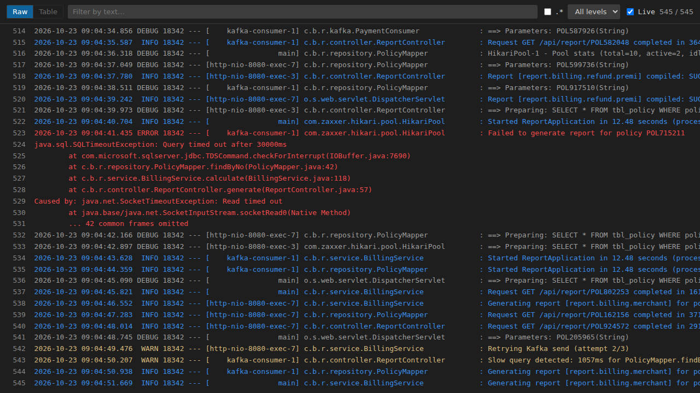
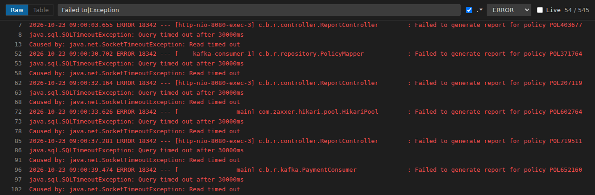
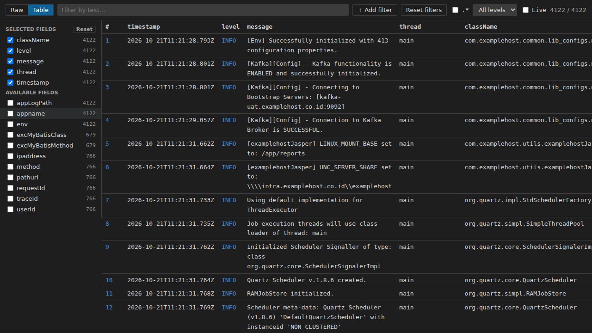
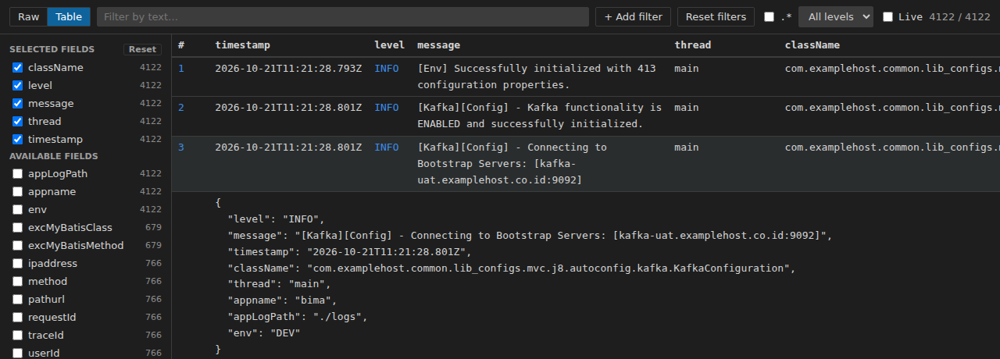
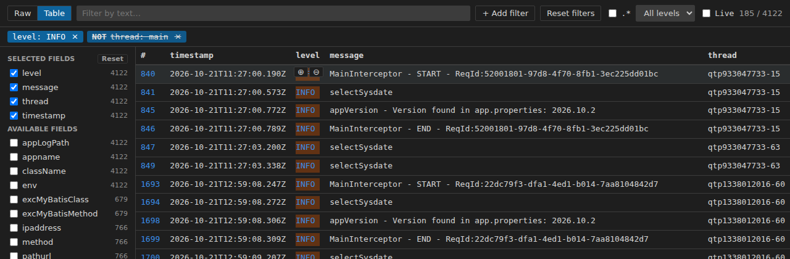
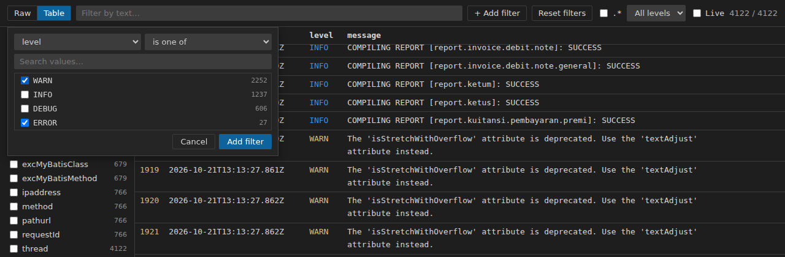
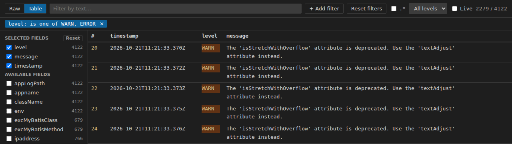
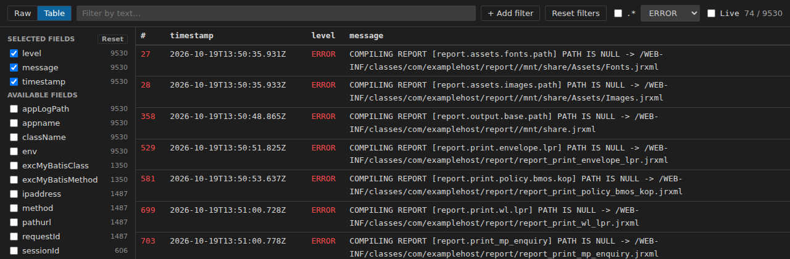
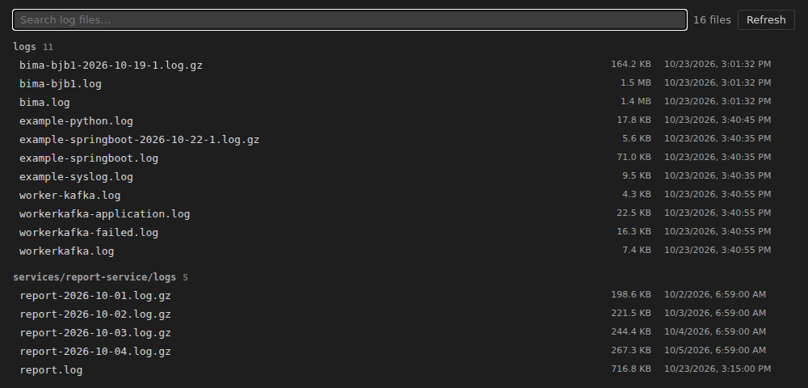

# Live Log Viewer

[English](README.md) | Bahasa Indonesia

Extension VS Code untuk membuka file `.log` dan `.log.gz` di viewer dengan warna per level, filter teks / regex / level, live tail, dan untuk log JSON, tabel ala Kibana dengan filter per field.



## Fitur

- **Membuka `*.log` dan `*.log.gz` secara default.** Editor teks biasa tetap tersedia lewat **Reopen Editor With…**.
- **Warna level**: FATAL (juga CRITICAL), ERROR (ERR), WARN (WARNING), INFO, DEBUG, TRACE. Level diambil dari field JSON `level` / `severity` / `log.level`, atau dari kata level di teks biasa. Baris tanpa level (stack trace, baris lanjutan) ikut level baris di atasnya.
- **Filter**: teks, regex (`.*`), dropdown level; penghitung menampilkan `tampil / total`.
- **Live tail**: file dicek setiap 0,5 detik dan hanya baris baru yang ditambahkan. File yang dipotong (truncate) atau dirotasi dimuat ulang.
- **Mode Raw**: nomor baris (tetap terlihat saat scroll horizontal), scroll horizontal + vertikal, klik baris untuk wrap / unwrap.
- **Mode Table** untuk log JSON (gaya Kibana Discover): sidebar field, kolom, baris yang bisa dibuka, filter sel ⊕ / ⊖, pill filter, "+ Add filter" dengan **is one of** / **is not one of**.
- **`.log.gz`**: didekompres di memori (streaming), tidak pernah di-extract ke disk.
- **Status bar `Logs: N`** dengan daftar cepat / daftar penuh semua file log di workspace.

## Instalasi

Dari source:

```bash
npm install
npm run install:local   # build VSIX dan install bila versinya berubah (tambah -- --force untuk install ulang)
```

Lalu jalankan **Developer: Reload Window**.

Atau build package lalu install manual:

```bash
npm run package
code --install-extension live-log-viewer-<versi>.vsix
```

## Cara pakai

### 1. Membuka file log

Buka file `*.log` atau `*.log.gz` mana pun dari Explorer; file terbuka di **Live Log Viewer**. Untuk melihat teks aslinya, pakai **Reopen Editor With…** → **Text Editor**.

Toolbar, dari kiri ke kanan:

| Kontrol | Fungsi |
| --- | --- |
| **Raw \| Table** | Ganti mode tampilan (Table abu-abu/nonaktif kecuali minimal separuh baris berupa objek JSON) |
| **Filter by text…** | Filter teks, tidak membedakan huruf besar/kecil |
| **.\*** | Perlakukan teks filter sebagai regular expression (regex tidak valid diberi border merah) |
| **All levels** | Tampilkan satu level saja |
| **Live** | Dicentang (default): baris baru muncul dan tampilan mengikuti akhir file. Tidak dicentang: tampilan dijeda; baris baru tetap dikumpulkan dan tampil saat dicentang lagi |
| `tampil / total` | Jumlah baris yang tampil setelah filter / baris yang dimuat |

### 2. Mode Raw, filter dan Live

Ketik di kotak filter, centang `.*` untuk regex, dan pilih level. Baris stack trace ikut level baris di atasnya, jadi filter **ERROR** tetap menampilkan setiap exception bersama stack trace-nya. Hilangkan centang **Live** agar tampilan tidak melompat ke akhir saat sedang membaca.



Klik baris untuk wrap (klik lagi untuk unwrap). Nomor baris tetap terlihat saat scroll ke samping.

### 3. Mode Table (log JSON)

Klik **Table**. Sidebar kiri berisi **Selected fields** (kolom yang tampil) dan **Available fields**, masing-masing dengan jumlah baris yang punya field itu. Centang field untuk menambah kolom, hilangkan centang untuk menghapusnya. **Reset** di header *Selected fields* mengembalikan kolom default (timestamp, level, message). Tabel di-scroll horizontal di areanya sendiri dan header tetap terlihat.



Klik baris untuk membukanya sebagai JSON yang rapi; klik lagi untuk menutup.



### 4. Filter field: ⊕ / ⊖ dan pill

Arahkan mouse ke sel untuk memunculkan **⊕** (filter nilai ini) dan **⊖** (kecualikan nilai ini). Setiap filter tampil sebagai pill di bawah toolbar dan sel yang cocok diberi highlight.

- Klik pill untuk mengganti antara include dan **NOT**.
- Klik **×** pada pill untuk menghapusnya.
- Pill yang panjang dipotong dengan … ; arahkan mouse untuk melihat teks lengkapnya.



Filter field juga berlaku di mode Raw (baris non-JSON seperti stack trace ikut baris JSON di atasnya).

### 5. "+ Add filter": is one of / is not one of

Klik **+ Add filter**, pilih field dan operator (**is one of** atau **is not one of**), lalu centang satu atau beberapa nilai. Nilai diurutkan dari yang paling sering muncul (500 teratas) beserta jumlahnya; pakai **Search values…** untuk mencari. Klik **Add filter**.





### 6. Tombol Reset

- **Reset filters** (toolbar): menghapus semua pill dan mengosongkan filter teks, regex dan level.
- **Reset** (header *Selected fields*): mengembalikan kolom default.

### 7. Arsip `.log.gz`

File `.log.gz` dibuka dengan cara yang sama. File didekompres di memori dan tidak pernah di-extract ke disk. Arsip tidak berubah, jadi tidak dipantau (Live tidak berpengaruh).



### 8. Status bar dan daftar file log

Status bar menampilkan **Logs: N**, jumlah file `*.log` / `*.log.gz` di workspace (`node_modules` dikecualikan, maks. 5000). Disembunyikan bila tidak ada file log dan diperbarui saat file log dibuat atau dihapus.

Klik item tersebut:

- **10 file atau kurang**: quick pick berisi nama, folder, ukuran dan waktu ubah (terbaru dulu), plus entri **Open full view…**.
- **Lebih dari 10 file**: tab **Log Files** langsung terbuka. File dikelompokkan per folder dengan ukuran dan waktu ubah; pakai kotak pencarian untuk memfilter dan **Refresh** untuk memindai ulang. Klik file untuk membukanya di viewer.



### 9. Command

| Command | Keterangan |
| --- | --- |
| `Live Log Viewer: Open File Logs…` | Sama dengan klik item status bar |
| `Live Log Viewer: Show All Log Files` | Buka tab **Log Files** |

Error dicatat di output channel **Live Log Viewer** (**View → Output**).

## Keterbatasan

- Saat file dibuka hanya 20 MB terakhir yang dibaca (juga 20 MB terakhir dari isi `.gz` yang sudah didekompres).
- Viewer menyimpan 100.000 baris terakhir dan merendernya tanpa virtual scroll.
- Mode Table hanya menampilkan field JSON level teratas; objek bersarang ditampilkan sebagai teks JSON.
- Popup "+ Add filter" menampilkan 500 nilai teratas sebuah field (pakai ⊕ / ⊖ untuk nilai lain).
- Hanya pola `*.log.gz` yang dikenali, bukan nama seperti `app.log.1.gz`.
- Pill filter, mode tampilan dan kolom tidak diingat setelah tab ditutup.

## Development

```bash
npm install
npm run compile          # TypeScript -> out/
npm run watch            # compile setiap ada perubahan
npm test                 # compile + unit test (node --test)
npm run package          # build .vsix (vsce)
npm run install:local    # build + install ke VS Code lokal (tambah -- --force untuk install ulang versi yang sama)
node scripts/screenshots.js   # buat ulang images/screenshots/*.png (butuh playwright-core + Chromium; jalankan npm run compile dulu)
```

## Lisensi

MIT
